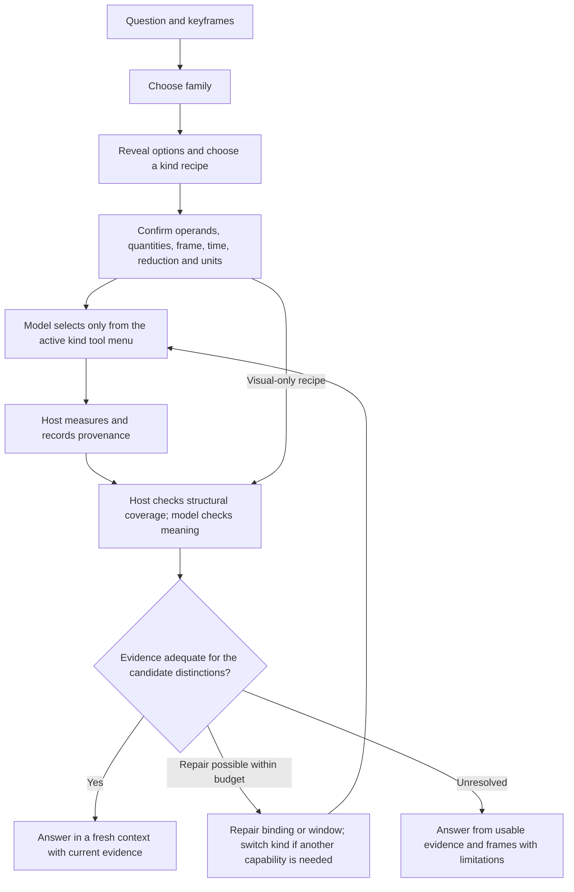

# AgentV5 workflow review

Review date: 2026-10-13. Scope: the implemented family → kind → measurement → answer workflow, its prompts and contracts, and the two complete DynBench runs at code revision `f809d95aee538983b1ecbfa7a82fbf1e6fb4db60`. This is a review and proposal; no agent implementation was changed.

**Assessment:** retain the small routing menus, explicit coordinate systems, cached reconstruction, and separation between model decisions and host computation. The largest weaknesses are incomplete observables behind broad kind names, insufficient recovery after a wrong decomposition, and an evidence contract that treats heuristic labels as more authoritative than their calibration supports. Tool redundancy is mainly overlapping views of shared state; merging all tools would not address the principal failures.

Evidence below is distinguished as **observed** (saved answers/traces), **verified defect** (implementation and, where noted, a CPU reproduction), or **hypothesis** (requires an ablation). A wrong answer alone does not identify the stage that caused it.

## Evidence and evaluation caveats

I read the implementation, all 21 measurement playbooks, the decomposition research notes, both runs' 5,600 answer records, the current 2,800-row baseline file, and selected full traces. The two runs cover the same 400 clips and 2,800 questions. Stored correctness agrees with predicted letter versus reference answer on every row.

| Method, same 2,800 questions | Correct | Accuracy |
|---|---:|---:|
| AgentV5 + Point4D | 1,646 | 58.79% |
| AgentV5 + D4RT | 1,626 | 58.07% |
| Frames-only Qwen, decomposition protocol | 1,671 | 59.68% |
| Qwen option log-probabilities | 1,720 | 61.43% |
| D7 decision flow, **current baseline artifact** | 1,794 | 64.07% |
| Evidence answer, falling back to frames when missing, current artifact | 1,723 | 61.54% |

Source runs: [Point4D](../results/agent_v5_eval2800_point4d_20261005T183754Z/report.md), [D4RT](../results/agent_v5_eval2800_d4rt_20261006T230228Z/report.md). Baseline: [eval_rows.json](../../dyn_dataset_exploration/outputs/decomposition_eval/eval_rows.json), SHA-256 `e3c2538912f46ab72c80b2d29466dc329e02d0f4962eaf7efa3ed832b1b65ef3` at review time.

**The archived reports and the current baseline artifact differ.** Archived AgentV5 reports quote D7 at 63.7%; `DECOMPOSITION.md` quotes 1,785/2,800, or 63.75%. The current file gives 1,794. Do not silently mix these snapshots. The conclusion is the same: AgentV5 is about five percentage points behind the flow, but the exact comparison must name the artifact.

Two reporting defects also matter:

- `report.py:paired` counts missing evidence answers as wrong. Currently only 2,420 evidence answers exist: 1,435/2,420 = 59.30%. Dividing by 2,800 gives 51.25%, an availability penalty presented as evidence accuracy. The archived 50.7% figure has the same problem. Report evidence coverage plus accuracy, or explicitly use the frames fallback on all 2,800 questions.
- `report.py:load_answers` derives a clip ID by removing only the final question index. This retains `qa_`, `sceneqa_`, and `cameraqa_`, giving 1,200 clusters instead of 400 physical clips. I recomputed paired bootstrap intervals using the catalog's `clip_slug`, resampling 400 clips with all seven questions, 2,000 replicates, seed 0. Point4D minus frames is −0.89 points [−3.04, +1.21]; versus letters, −2.64 [−4.57, −0.68]; versus the current D7 artifact, −5.29 [−7.00, −3.57]. D4RT minus Point4D is −0.71 [−2.14, +0.75].

Thus the runs do not establish a significant overall difference between backbones, nor between Point4D AgentV5 and frames-only Qwen. They do show a clear deficit versus the current D7 flow. They are not an isolated test of “agency”: routing, grounding, smoothing, evidence, answer prompting, and fallback policy differ together.

The [official-protocol Qwen report](../results/qwen3vl8b_dynbench_official_20261007T175618Z/report.md) additionally reports 60.6% on these 2,800 questions. Its full-benchmark 59.0% and task-macro 60.4% are different denominators/protocols and should not be compared directly with AgentV5's subset score.

The following subsets are fixed by the **Point4D agent's final kind**, with the other methods evaluated on those same question IDs. These are descriptive slices, not ground-truth kind annotations or isolated tool ablations.

| Agent-selected kind | n | Point4D | D4RT, same IDs | Frames-only, same IDs |
|---|---:|---:|---:|---:|
| camera_path | 282 | 59.9% | 61.0% | 46.5% |
| camera_zoom | 68 | 91.2% | 72.1% | 79.4% |
| camera_rhythm | 127 | 56.7% | 56.7% | 45.7% |
| scene_revisit | 60 | 71.7% | 76.7% | 58.3% |
| pair_relation | 406 | 56.4% | 56.2% | 62.8% |
| metric_speed | 93 | 24.7% | 16.1% | 36.6% |
| camera_viewpoint | 72 | 38.9% | 41.7% | 56.9% |
| cam_subject_elevation | 82 | 35.4% | 35.4% | 45.1% |
| event_order | 92 | 67.4% | 67.4% | 78.3% |
| instance_count | 48 | 43.8% | 47.9% | 58.3% |
| camera_shake | 84 | 40.5% | 21.4% | 39.3% |

## What the current tree actually permits

There are seven families and 23 kinds, including two VLM-only kinds. Family and kind are selected without options. A kind fixes slots and an exclusive tool menu. The agent can switch kind once, then sees the options only after measuring has permanently ended. `semantic` bypasses the measuring loop entirely. Final answering receives the accumulated conversation and every historical tool result again.

This is a constrained, mostly single-route workflow with local tool choice. It does not represent a complex question as a composition of independently checkable claims. In the Point4D run there are 3,768 tool results, 2.3 measuring turns per question including control actions, and only eight kind switches. Increasing the step limit is not the first intervention suggested by those numbers.

Sources: [kinds.py](kinds.py), [orchestrator.py](orchestrator.py), [contracts.py](contracts.py).

## Redundancy: what to consolidate and what to keep distinct

| Existing tools/kinds | Actual overlap | Recommendation |
|---|---|---|
| `camera_motion`, `camera_profile` | Same cached pose trajectory. First reports displacement/rotation; second derives speed and jitter. Static/moving interpretations can conflict. | Share one camera-kinematics record and motion-presence test. Expose compact views such as trajectory, tempo, and jitter. These are different reductions, not duplicate measurements. |
| `entity_track`, `motion_profile`, `speed` | Same entity position estimates, with different frames and temporal reductions. `speed` already includes net and path estimates. | Share one trajectory/kinematics record, with explicitly named reductions and units. Keep concise task-specific tool views if that is easier for the 8B model. |
| `visibility`, `apparent_size`, `entity_track(frame='image')` | Same masks supply presence, area, centroid, and border contact. `visibility` already prints size and position. | Introduce a shared 2D observation record. Request only the needed fields; apply one declared visibility/occlusion policy. Do not require depth for a 2D answer. |
| `event_onset`, camera/entity motion and visibility tools | Onsets are reductions of existing signals, but presently use partly separate definitions. | Add temporal predicates over shared signals: starts, stops, crosses, enters, exits; preserve the event's meaning and occurrence number. |
| `camera_zoom`, `camera_motion` | Zoom repeats forward camera translation as supporting evidence, but focal length is a distinct signal. | Share translation evidence and its provenance; retain focal measurement as a distinct observable. |
| `distance`, `region_relation` | Both report a distance trend, but point-to-point range and point-to-surface distance differ mathematically. | Do not collapse their semantics. A common API is reasonable only with an explicit geometry mode. |
| `cam_subject_range`, `pair_relation`, `metric_distance` | Same distance tool; operands, units, and reduction differ. | Reuse a distance recipe with typed operands, `value_at`/`trend`, and units. Keep user-facing routing descriptions if useful. |

The architecture already caches scenes and tracks. The opportunity is consistent semantics and less repeated evidence, not necessarily fewer expensive model calls. Two outputs derived from one imperfect track should not count as independent corroboration.

**Implementation choice:** first consolidate the backing calculations, while retaining the concise tool names the model already knows. In `Workspace`, cache three revisioned records: camera kinematics from poses, entity kinematics from tracks, and image observations from masks. Key them by source revision and processing configuration; derive window-specific summaries using one declared policy. `camera_motion`/`camera_profile` become views of the first record, `entity_track`/`motion_profile`/`speed` views of the second, and image trajectory/visibility/size views of the third. Give each result a `source_id` so verification recognizes shared provenance. Do not introduce a single large “measure everything” tool, and do not treat two summaries of one source as independent evidence. Interface consolidation can be evaluated later, after semantic consistency is established.

## Prioritized findings

### 1. Broad relation kinds hide missing observables — P0, structural coverage defect

`pair_relation` sounds like general relative position but only permits scalar `distance`. `landmark_relation` offers distance, nearest-surface distance, and an individual trajectory. None returns a signed displacement between two entities in a specified reference frame, a crossing event, containment, or an object's bearing relative to a landmark.

**Why this must fail on some questions:** the scalar `||p_a − p_b||` is unchanged by rotating the relative vector. Two entities can swap left/right at constant separation. Even perfect distance measurements cannot distinguish those options. Likewise, nearest distance to a road does not establish motion along it versus across it, or which side of a boundary the subject occupies.

**Observed:** 192/406 `pair_relation` questions have at least one option containing left/right/behind/in front/above/below/alongside/side-by-side (a lexical screen, not an annotated gap count). AgentV5 scores 105/192 versus frames-only 111/192. In `qa_ytvis_3c8320669c_c1d15d59_1`, all options concern ahead/behind and left/right relative to other surfers. The agent measures a fluctuating scalar distance and selects ahead-left; the reference is ahead-right. This demonstrates a missing observable; it does not prove that adding it would fix this particular video's grounding.

**Fix:** add `relative_position(a,b,frame,window)` returning signed offsets/bearings, with reference identity and axis definition. Use reference-body axes only when the question requires them and facing is available. For regions, add signed boundary/inside-outside evidence where a meaningful region model exists. Describe the current distance recipe as “pair distance change”; retain its existing kind ID initially for replay compatibility.

**Concrete change:** in `kinds.py`, make the relation recipe distinguish `range`, `relative_position`, and `boundary_relation` requirements. Add `relative_position` to `tools.py`, backed by `measure.py`: compute `r(t) = B(t)^T (p_subject(t) - p_reference(t))` for an explicitly defined orthonormal basis `B`. Return the signed components, axis meanings, time samples, endpoint values, and requested reduction. A scalar range must never satisfy a signed-position requirement. Start region support with image-space boundary crossing/containment where a valid mask exists; label it as projected image geometry. Leave 3D containment and along/across relations unresolved until a valid boundary or reference axis is available. Do not invent a road direction from nearest distance.

**Acceptance check:** constant-distance trajectories that exchange left/right must produce opposite signed relations. A turning reference must distinguish initial-reference and current-reference axes. Missing depth may allow image-left/right, but must not produce unsupported 3D ahead/behind.

### 2. Options arrive too late for evidence selection — P0, design limitation

`apparent_size.md` says to measure distance “if the options name causes”; `landmark_relation.md` conditions direction measurement on the options. Those instructions cannot be followed because options are hidden until `_answer`, where only `final_answer` is allowed.

Questions such as “How does the relative position change?” are underspecified without their candidate claims. Compound options can require distance **and** bearing **and** visibility. The tree commits to one kind before those distinctions are available. A correct final-stage recognition of missing evidence cannot trigger another measurement.

**Fix:** my recommended first implementation keeps question-first family selection, then reveals options **before kind selection and slot filling**. Have the model identify the observables that distinguish the candidate claims; retrieve only the required tools. Add an option-aware verification round before answering, even when the initial route is semantic. Answer options are task input, not ground truth. Measurement functions remain entirely option-blind.

**Concrete change:** in `orchestrator.py:_decompose`, pass question, options, and frames to kind/slot decisions. Populate a small requirement list in `QueryProgram`, using the selected kind as its default recipe. In `_measure`, change `done_measuring` to enter verification instead of immediately entering `_answer`. Verification returns `sufficient`, `needs_measurement`, or `unresolved`, with requirement IDs and one next action. Permit one repair cycle within the existing action budget as an initial experimental setting. A semantic route still reaches verification and may request geometry; a visual-only answer remains valid when geometry is unnecessary or unavailable.

**Acceptance check:** for options differing only in left/right at equal distance, the plan requests signed position or records that it is unavailable. An option-dependent instruction in a playbook must execute while measurement is still possible. Compare this design against late options plus repair under matched budgets.

**Tradeoff:** early options may anchor interpretation. Test early options against late options plus a repair round, using shuffled labels and matched budgets. Do not assume that exposing more tools or more tokens improves performance.

### 3. Labels, noise marks, and the answer prompt disagree about authority — P0, verified contract problem

The system says labels are descriptive summaries; the final prompt says not to overrule them using the numbers. It also says every unstarred value means “no real change,” although speed, area, angle, and distance tables contain many meaningful unstarred values. `*` applies only to selected change columns. A threshold for a benchmark class is also different from an uncertainty/noise bound: a measured change can be real yet too small for a coarse class label.

**Verified defects:** with synthetic, noise-free scenes, `measure_camera_motion` returns `static` for both a 78° pure roll and a three-scene-scale lateral excursion followed by return. Roll is printed but absent from the active-motion strengths; translation uses its net value with `cam_trans_peak=0`. `tool_camera_motion` then expands `static` into the claim that no rotation or translation reached the thresholds. The answer prompt reinforces that claim. Five actual camera-rhythm questions contain a static camera-motion label alongside a non-fixed, non-shaky rhythm label.

**Fix:** define separate facts: any motion, net displacement, peak excursion, dominant motion, tempo, and jitter. Include roll. Make static require insufficient evidence for motion across the interval, rather than a small endpoint displacement. Render the same underlying definitions in every tool view. Distinguish “change below calibrated class threshold” from “change unresolved given uncertainty.” Limit star instructions to the columns that actually use them.

A shared output should name the observable, coordinate frame, window, units, estimator uncertainty, class threshold, and unavailable components. Preserve the model's responsibility to interpret those facts; remove the blanket label-veto instruction.

**Concrete change:** in `measure.py`, derive one shared camera motion record containing translation excursion, net translation, path length, and full rotation including roll. Test motion over the interval, not only between endpoints; report translation and rotation dominance separately rather than comparing metres and degrees directly. Use `motion_detected`, `no_motion_detected`, and `unresolved`, with the last state covering inadequate observations. `camera_motion` and `camera_profile` must consume this same record. In `render.py`, attach noise marks only to named columns; in `prompts/answer.md`, replace the blanket rules with:

> A class label is a threshold-based summary of its named quantity and interval. Check that these match the question. An unmarked number is an ordinary measurement unless its column explicitly defines noise marking. Separate class thresholds from measurement uncertainty; neither missing evidence nor a small net change establishes absence of motion.

**Acceptance check:** pure roll and an out-and-return path both register motion. Invalid pose coverage returns unresolved. Two views of the same trajectory cannot disagree about motion presence through different definitions.

### 4. Chronology is imposed where the question may request dominance or net change — P1, prompt defect

`system.md` tells the model to privilege early motions even when a later motion is largest. The example also wrongly says “turns left and moves backward” would require backward to come first. `answer.md` applies the rule unconditionally. Meanwhile, `camera_path` explicitly asks for a dominant motion, `camera_translation` concerns displacement, and an ordered trajectory is another reduction altogether.

**Fix:** choose the reduction explicitly: ordered sequence, net displacement, dominant motion, value at a time, temporal trend, or onset order. Chronology governs sequence answers; it does not override a request for the primary motion. For a sequence, include every material event supported by the question/options, including later movement. Preserve reversal direction: closer-then-farther and farther-then-closer are not interchangeable just because both fluctuate.

**Validation:** use a small synthetic bank where earliest, largest, and net directions differ. Replay the same measurements with only the reduction instruction changed. The current camera-path gains should be protected while fixing this inconsistency.

**Concrete change:** make `Measurement.reduce` mandatory after recipe expansion, with a documented set such as `value_at`, `net_change`, `ordered_sequence`, `dominant_motion`, `trend`, and `onset_order`; reject incompatible quantity/reduction pairs in `contracts.py`. Define dominance for each quantity, exposing its duration and magnitude evidence rather than assuming “first” or “largest endpoint.” Replace the global chronology instructions in `prompts/system.md` and `prompts/answer.md` with:

> Use temporal order when the question asks for a sequence or before/after relation. For net change, compare the requested endpoints. For primary or dominant motion, use the declared dominance summary over the requested interval. An early movement does not automatically outrank a later movement. Preserve reversals when the candidate claims distinguish their order.

**Acceptance check:** the same early-left/later-right trajectory can support “left then right” for sequence and “right” for net change without a prompt contradiction. Correct the reversed wording in the existing system example.

### 5. Grounding, counting visualization, and evidence identity need repair — P0 for concrete defects

**Observed:** 45/2,800 decompositions exhaust slot retries and fall back to `semantic`; every one is a slot failure. The lexical constraint can reject a visible subject absent from the question's nouns, such as an entity named only in the options. Conversely, `phrase_in_question` accepts any overlapping word: a CPU check accepts “red car” for a question about a “red person.” This is not semantic identity validation.

Default grounding is prompted at frame 0, then a longest-lived/confident instance is selected automatically. A more salient instance is selected for implicit main subjects. These are useful proposals but do not establish that the selected instance is the intended one. `_SUBJECT` does not permit visual naming in several kinds where `_MAIN_SUBJECT` does.

**Counting has a concrete broken recovery path:** category tracks are named `c1#k`. `viz.render(..., 'entities')` passes those IDs to `Workspace.masks_at`, but `Workspace.entity` only resolves registered IDs and bracketed group members. In the Point4D traces, `show` raises this error on **18 of the 48 counting questions**. Thus the playbook's visual verification step is unavailable precisely where it is needed. Ground/select tables also use raw zero-based instance indices while count displays use one-based row numbers, making identity mapping harder.

**Verified cache defect:** re-grounding `e1` does not clear an orientation cache key such as `e1@0,5`; invalidation splits on `[` rather than `@`. `select` does not clear orientation cache entries at all. In addition, final answering includes historical evidence after re-grounding or selection without marking it superseded. There are 146 questions with a grounding/selection action after an earlier measurement; this is exposure to stale-evidence risk, not 146 proven stale-evidence failures.

**Fix:** stable entity/instance IDs across grounding, visualization, selection, and measurement; an explicit distinction between a semantic referent and its short SAM prompt; visual confirmation when multiple candidates or a weakened prompt makes identity ambiguous; and revisioned evidence. Any identity change must invalidate dependent orientation/track results and mark old measurements superseded. Permit visually grounded implicit subjects consistently instead of forcing lexical agreement where the question cannot supply a noun.

Count each category over an explicit scope (whole clip, instant, interval; all unique instances versus simultaneously visible). The current `count` API cannot accept a window; a real question asks for vehicles in the background at the start. Protect the counted category across re-grounding. Do not call the measured count a guaranteed lower bound: missed detections undercount, but fragments/false positives can overcount.

**Concrete change:** extend entity bindings with `source` (`question`, `option`, or `visual`), `source_span` when present, a semantic description, and a separate segmentation prompt. Replace any-word overlap as the identity gate with source validation plus model confirmation for visual/paraphrased referents. In `Workspace`, use one instance-handle resolver for `ground`, `select`, `show`, and `count`, including existing `c1#k` handles. Increment a binding revision whenever grounding or selection changes. Key orientation/track caches by `(entity_id, revision, sample_positions)` and tag dependent results with those revisions. Keep superseded results in the audit log but exclude them from current evidence. Extend `count` with `window`, spatial scope where supported, and explicit `unique_visible` versus `simultaneously_visible` semantics; return the counted handles for inspection.

**Acceptance check:** every handle returned by count can be displayed and selected. Re-grounding and selection invalidate orientation and earlier measurements. “Red car” cannot pass solely because “red person” appears in the question. Start-of-clip count excludes later arrivals under the requested scope.

### 6. Group geometry is reduced to one or two representatives — P1, observed coverage hole

Groups are constructed as two instances when two slot phrases match. Otherwise a plural phrase can become a single `object`, whose resolver selects one track. There is no group arrangement/spread measurement.

**Observed:** `sceneqa_ytvis_1e1a18c45a_ddf0ed15_0` asks about the seals' spatial arrangement. The agent names a left seal and a right seal and measures their separation growing by 3.22×. It chooses “clustered → spread out”; the reference is “scattered → gather.” A chosen pair's separation is insufficient to characterize the whole group. The surfer example in finding 1 likewise resolves “other surfers” as one object despite finding five candidates.

**Fix:** preserve cardinality and set-valued operands. Add `group_configuration(group,frame,window)` with member coverage, centroid, robust pairwise spread, relative ordering, and cluster/line evidence. Track membership changes separately from movement of persistent members; an entering or leaving member can otherwise create artificial changes in spread. Start with spread and relative ordering required by real questions rather than an unrestricted scene-graph system.

**Concrete change:** add `cardinality: single | pair | group` to entity bindings in `program.py` and retain the requested group in `scene.py` rather than selecting one candidate. The first `group_configuration` implementation should return member IDs, observed membership over time, and median pairwise separation over a consistent set of members. Report membership changes separately and mark insufficient common membership unresolved. For a subject relative to a group, require an explicit aggregation such as `each_member` or `median_position`; do not silently substitute one representative. Defer cluster/line labels until their observables and thresholds are specified and validated.

**Acceptance check:** a group can contract even when one chosen pair separates. Adding a distant new member changes the membership report without being mistaken for expansion of the original members. The surfer plan retains all intended reference surfers or explicitly reports incomplete coverage.

### 7. Event routing promises more than the event tools support — P1, observed coverage hole

The family description promises things an entity does, but the predicate inventory is limited. `other` loses the original action text in the stored event description; `stops_moving` is an allowed slot value that the tool explicitly refuses as having “no geometric signal.” A stop can be measured from a speed transition, subject to noise and visibility. Directional camera translation is absent from event predicates.

**Observed:** 45/92 event-order questions contain at least one `other` or `stops_moving`; their event predicates contain 56 `other` and four `stops_moving` values in total. There are 57 unavailable event-onset results. The full event-order subset scores 62/92 versus frames-only 72/92. Even the 47 questions without those two predicates score only 30/47 versus frames 36/47, so an action detector alone will not fix event order.

Example: `cameraqa_ytvis_1bd67fde94_9fe86a87_1` asks when leftward **translation** starts relative to a skydiver crossing the view. The camera event is encoded as `pan_left`, and the crossing as `other`. Neither is the requested event.

The onset implementation further equates starts-moving with displacement crossing a threshold, first visibility with entry, and last disappearance with leaving. Those are different temporal semantics. A small early movement can cross a displacement threshold later than a larger movement that began later; an entity already visible at the first frame has a censored onset, not a known entry time of zero. The onset tool also ignores the program's window and always searches the clip.

**Fix:** preserve the original event phrase and temporal scope; validate actor/predicate compatibility. Add transitions for translation, speed, orientation, and boundary crossing. Add a visual event-localization tool for non-geometric actions, using relevant crops plus context and denser frames when available. Return onset intervals, first-observed versus known onset, absent/unknown states, and occurrence indices. The model interprets event meaning; host code compares intervals and reports overlap/uncertain order.

**Concrete change:** preserve the source phrase in `Event.text` even for an unsupported predicate. Split camera `pan_left` from `translate_left`. Implement starts/stops as transitions of the shared speed signal with separate on/off thresholds and a minimum dwell time in seconds, fitted only on dev data; search only the requested window and occurrence. Return the last-false/first-true time bracket, not a falsely precise instant. Visibility already true at the first observed frame is left-censored, not a known entry. Route unsupported actions to a proposed `locate_visual_event(text, actor, window, occurrence)` tool; it returns supporting frame IDs and an interval or unresolved state, without forcing a geometric substitute. Keep this visual extension behind a separate ablation.

**Acceptance check:** translation is never relabelled pan; `stops_moving` is supported; repeated events honor the occurrence/window; occlusion gaps do not become stops. Overlapping onset intervals yield uncertain order. Frame indices remain usable when trustworthy seconds are unavailable.

### 8. Metric speed is systematically misleading; the proposed net-to-path fix is insufficient — P0 for interpretation, P1 for estimator work

`speed` advertises average speed but chooses `speed_mode='net'`. Endpoint displacement divided by time is not path speed for a returning/curved trajectory. **Both net and path numbers are already printed** by the evaluated implementation. Adding the path number is not a new fix.

**Fresh audit:** of 93 metric-speed questions, 83 have a numeric reading and numeric options suitable for this comparison. Using the last speed result per question, median net estimate/reference-option value is 0.360; path is 0.444. Nearest option in log space is correct on 19/83 for net and 20/83 for path. These reference values are benchmark answers, not physical ground-truth velocity; nevertheless the result strongly argues against treating a mode switch as the solution. D4RT scores 16.1% versus Point4D 24.7% on this same subset.

The estimates depend on world position, temporal coverage, smoothing, noise subtraction, and metric scale. The position estimate is a median of currently visible masked 3D surface points, not necessarily the same physical point over time. Posture, occlusion, and segmentation can move that estimate. D4RT explicitly takes native units as metres; its documentation acknowledges a scale discrepancy with DA3. Naming the source does not make those readings calibrated metric evidence.

**Fix:** distinguish `net_displacement_rate` from `path_speed`; show observed duration and gaps. On dev clips, separate scale bias from trajectory shape/noise by testing both quantities, scale reliability, gap handling, and stable tracked anchors. Return a defensible interval or unreliable state rather than a universal “about 2×” caveat. Until validated, test suppressing numeric speed evidence or presenting it only when independently reliable. Do not fit a correction factor on these eval answers.

**Concrete change:** remove the ambiguous primary `speed` scalar in `tool_speed` and label both existing quantities explicitly. In `measure_metric_speed`, compute elapsed time from actual timestamps and sum only contiguous observed increments for path length. Divide by the duration of those observed segments and label the result `observed_path_speed`; do not present it as a whole-window average when gaps remain. Return full-window coverage, gap spans, coordinate units, scale provenance, and estimator method. Treat stable-anchor tracking as a separately evaluated estimator change, not a prompt repair. Compare net/path, noise subtraction on/off, gap policy, and scale reliability on dev clips before choosing the production estimator. Without validated metric scale, mark the metric requirement unresolved and let the agent use visual evidence.

**Acceptance check:** a constant-speed synthetic path is invariant to uneven timestamp sampling; an out-and-return path has positive path speed and near-zero net rate; a missing middle segment is disclosed instead of filled as stationary. Validate real-video numeric error and answer impact separately.

### 9. Heuristic confidence and thresholds do not transfer automatically — P1, observed calibration risk

The thresholds were copied from the decomposition study's dev fit while AgentV5 changed boundary sampling and camera smoothing. They are then reused unchanged for D4RT, which has at most 32 frames and infers focal length from reconstructed points. D4RT's pose recovery can hold the preceding pose when fitting fails, without exposing that imputation to these tools.

Confidence is often `high` by default or based on interior-cell count, frame count, or mask stability. That says little about semantic identity, metric scale, reconstructed focal length, or correctness of an inferred class. For example, 88 metric-speed questions have an available `speed` result marked high confidence, but the final agent answer is correct on only 22. This is not a calibration curve for speed accuracy; it illustrates why the label cannot be read as answer confidence.

**Observed:** changing backbone preserves the final kind on 2,774/2,800 questions but changes many answers. On matched subsets zoom falls 91.2% → 72.1%, shake 40.5% → 21.4%, and speed 24.7% → 16.1%. This implicates the evidence/calibration interface as a priority; it does not isolate sampling from backbone estimation error.

**Fix:** expose sample times/density, pose validity/imputation, scale source and uncertainty, gravity quality, identity ambiguity, and coverage separately. Calibrate label thresholds for the actual smoothing/sampling/backend configuration on dev data. Use the actual `t_s` differences in temporal derivatives; several camera/profile functions substitute one effective frame rate for potentially uneven sampled timestamps. Shake needs an explicitly supported temporal bandwidth and should be unavailable when it cannot be resolved. “Low rate understates shake” is not a sufficient account of reconstruction residuals.

Evaluate whether evidence helps as a function of these signals, and plot error against evidence-use coverage. Selective prediction provides the relevant risk–coverage framework, but its benefits here must be demonstrated locally: [Geifman and El-Yaniv, 2017](https://arxiv.org/abs/1705.08500).

**Concrete change:** replace the single `high/medium/low` interpretation with named quality fields: observed coverage, valid-pose fraction, imputed-pose fraction, identity ambiguity, metric-scale status, and sampling gaps. Do not manufacture numeric uncertainty where no estimator supports it. Carry pose-fit validity out of `backbones/d4rt.py` into the scene and result records. Attach a calibration fingerprint to class thresholds: backbone, sampling policy, smoothing, metric source, and fit version. If the fingerprint does not match, return the numeric observable with an uncalibrated-label flag rather than silently reusing a confident class. For shake, specify the temporal frequencies the samples can support and return unresolved when the requested distinction exceeds that support.

**Acceptance check:** inserting held poses changes coverage/quality and cannot strengthen a static label. Switching backbone invalidates incompatible calibration metadata. Reliability claims are accepted only after dev-set error-versus-coverage evaluation, not because the confidence wording sounds more cautious.

### 10. Temporal windows and visual inspection are too rigid — P1, verified defect and observed exposure

The regex treats a single timestamp as an instant except for a narrow “from the start” pattern. CPU reproductions parse both “during the first 2 seconds” and “over 5 seconds” as instants. The actual catalog contains “Between the start and the 8-second mark,” also stored as an instant. The model sometimes repairs a window in the subsequent tool arguments; that does not make the initial contract sound.

Only two Point4D traces use `choose_window`. Phrasings such as “Between the moment the server tosses the ball and the moment they land” fail the event-anchor regex and become whole-clip windows. The question requires two localized events. `show` has no time/window parameter and displays four fixed keyframes, so it cannot implement targeted temporal verification.

**Fix:** distinguish instants, intervals, durations, relative phases, and event-bounded intervals. Let the model validate the proposed window with a short structured decision where parsing is uncertain; retain the rule-based fast path for unambiguous timestamps. Support `show_frames(times/window, entity)` and event-window refinement. Every tool should return its requested and actual window, temporal resolution, missing spans, and any boundary clipping.

For these repairs, preserve the verified DynBench GF frame mapping and source-specific frame rates in [DECOMPOSITION.md](../../dyn_dataset_exploration/logs/DECOMPOSITION.md). Do not replace them with the files-on-disk index or an assumed video FPS.

**Concrete change:** in `window_from_question`, parse “during the first 2 seconds” as `[0,2]` and “at 2 seconds” as an instant. A bare duration such as “over 5 seconds” needs an anchor; mark it unresolved rather than assuming either an instant or a start time. Represent two-event bounds as two event references and localize both. Invoke `choose_window` when parsing leaves ambiguity, showing the source phrase and proposed interpretation. Extend the `show` schema with explicit times or a window and a bounded frame count; include requested boundaries and permit denser inspection around uncertain events. Centralize window resolution so `distance`, `count`, and `event_onset` inherit the program window when not explicitly overridden.

**Acceptance check:** cover instant, anchored duration, ambiguous duration, two-event interval, and out-of-range clipping. The same requested window produces the same resolved bounds across tools. Inspection can show a late event that is absent from the four default keyframes.

### 11. Family/kind names mix operands, quantities, frames, and reductions — P1, routing ambiguity

The hierarchy mixes who moves (`camera`, `subject_motion`), operands (`two_entities`), observer relation (`subject_vs_camera`), units (`metric_speed`), coordinate frame (`traj_subject_own_frame`), and reduction (`event_order`). These are partly independent choices.

Specific boundaries:

- `camera_viewpoint` versus `cam_subject_elevation`: “shooting angle” can mean either. Of 71 rule-labelled elevation questions, 11 route to viewpoint and seven to camera path. These rule labels are useful diagnostic labels, not an oracle for every paraphrase.
- `subject_direction` versus `traj_subject_own_frame`: “forward” can mean heading-relative, scene depth, or camera-relative motion. The subject-direction playbook tells the model to use moving-camera axes whenever it sees “relative to the camera,” despite the decomposition research reporting that this wording often follows fixed initial-camera axes in DynBench.
- `camera_translation`: its playbook says “camera's own axes,” but the tool returns gravity-levelled initial-camera axes. Current camera axes and initial axes diverge after a turn.
- `entity_track(frame='own')`: the implementation freezes the first usable orientation, whereas “relative to where it faces” can mean a rotating body frame. A subject that turns while continuing to walk forward is different under these definitions.
- `orbit_direction`: opposite-sign pan and lateral motion is a heuristic that does not use the subject's location. Changing viewing side can also come from the subject turning. Neither establishes camera orbit about that subject.

**Fix:** retain family as a navigation hint, but explicitly choose operands, quantity, frame, time, reduction, and units. Names such as `camera_elevation_to_subject`, `camera_bearing_in_subject_frame`, `body_heading_change`, `pair_distance_change`, and `displacement_in_initial_camera_frame` make the distinctions easier to review. Add `body_at_start` versus `body_at_each_time` where supported. An orbit measurement should use the time-varying camera–subject vector, angular change about gravity, radius consistency, and separate camera/subject motion.

This can still use one small decision per call. It does not require presenting one giant schema to the 8B model.

**Concrete change:** initially retain kind IDs but rewrite each description to name its quantity and exclusions: `cam_subject_elevation` is the camera–subject vertical angle; `camera_viewpoint` is camera bearing relative to subject facing; `subject_direction` is displacement in an explicitly chosen frame. Add precise frame choices, including `initial_camera_levelled`, `current_camera`, `image`, `body_at_start`, and `body_at_each_time`, with axis definitions and required inputs. Distinguish “change of relative coordinates in a moving frame” from “physical displacement expressed in that frame”; a camera turn can change the former without subject motion. Remove the automatic wording-to-frame rule. Ask a small frame decision when meaning is ambiguous and carry that assumption into the evidence.

For orbit, propose `orbit_about(subject, window)`: measure angular sweep of the camera–subject vector about gravity, radius variation, and camera and subject trajectories separately. A static camera with a moving subject must not be certified as camera orbit merely because relative bearing changes. Use the current pan/truck pattern only as a diagnostic cue.

**Acceptance check:** distinguish elevation from subject-facing bearing, body turn from translation, and initial-camera from rotating-camera axes. Rotation in place must not establish orbit. Store original and revised family/kind values for diagnostic comparisons.

### 12. Recovery is shallow, and the final answer repeats stale reasoning — P1, design limitation

The switch schema says “a kind from the menu you were shown,” which normally contains only the current family's kinds. The implementation accepts any kind globally, but those alternatives are not discoverable through the contract. A semantic route cannot switch because it never enters the tool loop. A switch retains slots and appends only entity IDs not already present; it does not rebuild or validate existing semantic bindings. `family` is not updated on a cross-family switch.

Eight observed switches and two correct outcomes show limited use, not that switching is inherently harmful. Recovery cases are selected because something is already difficult. Similarly, poor accuracy after `show` or repeated calls is not causal evidence that those actions should be removed.

`_answer` restores every tool result in full while preserving earlier reasoning. Context trimming cannot remove the newest answer dossier, and estimated peak contexts exceed the 16,000-token budget (18,841 Point4D; 20,087 D4RT). With no tool results, AgentV5 still scores only 140/192 versus frames-only 148/192 on those same questions. Conversation history, output prompting, or routing selection can therefore contribute independently of geometry.

**Fix:** allow one explicit `revise_plan` step with cross-family candidate descriptions, including recovery from semantic/no-tool routes. Rebind entity slots and invalidate dependencies when their meaning changes. Answer from a compact current evidence record that excludes superseded measurements and rejected attempts; identify any unresolved claims. Test a fresh answer context against the existing history to measure reasoning carryover rather than assuming it helps.

This preserves the useful reasoning–action–observation loop while permitting observations to revise the plan, the motivation behind [ReAct](https://arxiv.org/abs/2210.03629). That paper supplies a design principle, not evidence of a guaranteed AgentV5 gain.

**Concrete change:** replace the one-use `switch_kind` action with `revise_plan(reason, unmet_requirement)`, which retrieves a short cross-family recipe menu and then uses the existing small selection calls. The selected repair recipe replaces the active tool menu; it does not expose or accumulate the global tool catalog. Retain valid evidence already collected, rebuild and validate affected slots, and update family/kind and evidence dependencies together. Initially allow one verification/repair cycle under the same 16-action ceiling, logging exhausted repairs rather than looping indefinitely. Build `_answer` from a fresh conversation containing question, options, frames, the current plan, current evidence, and unresolved requirements. Summarize time series according to the requested reduction; retain raw measurements in the trace. For a visual-only plan, use a matched frames-only answer prompt. Budget the assembled final context, including images and output headroom, before dispatch.

**Acceptance check:** a semantic route can request a missing measurement; a cross-family repair does not retain an old slot meaning; superseded evidence never appears in the final dossier; long histories cannot push the final request beyond the configured context limit. Test fresh-context answering independently of the new planner.

### 13. The answer-template A bias is plausible, not established as the main cause — P1, inexpensive ablation

The literal `"letter": "A"` example is an avoidable prompt risk. AgentV5 predicts A 1,331 times versus 1,052 A references, and the matched frames-only baseline has a much closer distribution. Replace the concrete example with an allowed-letter placeholder.

However, the previous error analysis calls this “likely the largest single fix” without an intervention. Numeric options confound that diagnosis: A is the smallest numeric speed option on 87/93 speed questions, and speed estimates are systematically low. Fixing the template cannot repair low metric scale or a missing relative-bearing measurement.

**Validation:** replay identical evidence and frames with (a) the placeholder, (b) shuffled option order with inverse mapping, and (c) a clean answer context. Measure semantic-choice consistency and paired accuracy, not just whether the letter histogram becomes more balanced. A uniform letter distribution is not the objective.

**Concrete change:** remove the filled-in answer example from `prompts/answer.md`; instruct “Set `letter` to one of the option labels shown,” using the existing `final_answer` schema to constrain output. No particular valid letter should appear as the example answer. Add an offline replay condition with several seeded option permutations, map predictions back to original option identity, and hold evidence, frames, and decoding settings fixed. Keep this separate from rerunning the option-aware planner, which tests a different source of option sensitivity.

**Acceptance check:** valid structured answers remain unchanged in format. Report paired correctness and semantic-choice agreement across permutations, with uncertainty, rather than treating a reduced A frequency as success.

### 14. A 2D fallback currently depends on successful 3D — P1, verified capability defect

`entity_track(frame='image')` requires `_first_present`, which filters on finite smoothed 3D positions, before it can use valid 2D centroids. A CPU reproduction with all 40 masks/centroids present and no 3D positions returns “unavailable.” Thin/distant objects are precisely where 2D should remain useful. The image view also mixes image fractions and scene-scale depth in its “moved” norm.

**Fix:** make image position a standalone 2D signal with its own validity mask and units. Return depth separately when available. Keep 2D identity/presence/area/crossing tools functional without a scene reconstruction. This is dependency removal, not a new model requirement.

**Concrete change:** branch `tool_entity_track(frame='image')` before any 3D-only `_first_present` check. Derive validity from the mask and finite image centroid; report horizontal/vertical coordinates in normalized image units with an explicit origin and axis convention. Compute 2D displacement using only those two coordinates. Optional depth is a separate quantity with separate units and validity. Make image-only tool dependencies request segmentation/tracking, not successful scene reconstruction; reuse the same observation record for visibility and apparent size.

**Acceptance check:** the existing 40-frame valid-mask/no-3D example returns image trajectory, presence, and size. Adding or removing unavailable depth does not change the 2D displacement. A left/right image crossing remains measurable after 3D reconstruction fails.

## A smaller, more compositional workflow

**Recommended first revision:** preserve Family → Kind → a small, enforced measurement-tool menu. Kind remains responsible for reducing the agent's choices and also supplies a default measurement recipe. The change is that an explicit, bounded repair step can replace the selected kind and its menu when necessary. Show options before choosing the kind and verify evidence before answering. Ordinary measurement turns never expose the global tool catalog.



The corresponding implementation should have these boundaries:

| Stage | Exact proposed behavior | Main edit |
|---|---|---|
| Family | Retain the seven-family menu and existing IDs. Treat it as an initial retrieval hint; record later revisions. | `kinds.py`, `_decompose` |
| Kind | Show options; choose from the family's small kind menu. The selected kind defines both the enforced tool menu and default evidence requirements. | `choose_kind.md`, `KindSpec`, `tools_for` |
| Plan | Confirm only ambiguous fields through small calls. A requirement names a quantity, operands/cardinality, frame, window, reduction, and units. Compound candidate claims may need several requirements. | `program.py`, `contracts.py`, slot prompts |
| Measure | Offer the active kind's measurement tools plus grounding/inspection/control actions. Validate against that menu; tools outside it remain inaccessible until an explicit kind repair. | `_measure`, `tools_for`, tool capability descriptions |
| Verify | Match evidence to requirements structurally, then ask the model whether the measured quantities distinguish the candidate meanings. Permit one repair cycle initially, including from semantic routes. | Proposed `_verify` and `revise_plan` actions |
| Answer | Assemble a fresh, budgeted context with frames, question/options, current evidence, assumptions, and unmet requirements. Preserve history only in the audit trace. | `_answer`, `answer.md` |

Recipe defaults should remove work, not guess away ambiguity. For example, “distance in metres at 2 seconds” fixes quantity, units, and reduction; “moves forward” still needs a frame decision. A kind can propose a default, but the resulting plan must expose the chosen meaning. The 8B model should never have to emit the complete expanded plan in one large JSON response.

### How kind selection continues to reduce choice workload

Keep `tools_for(active_kind)` and the action validator as the runtime access gate. Only that menu's schemas appear in the measurement prompt. Each kind normally exposes one to three measurement tools, with a shared small set of grounding, inspection, and control actions. The following examples describe the proposed menus; `relative_position` is a proposed addition:

| Selected kind | Measurement tools shown | What the recipe supplies |
|---|---|---|
| `cam_subject_range` | `distance` | Camera–subject operands and range-change requirement |
| `subject_direction` | `entity_track` | Displacement requirement; confirm frame only when ambiguous |
| `metric_speed` | `speed`, `motion_profile` | Speed quantities, metric-scale requirement, and coverage checks |
| `pair_relation` | `distance`, `relative_position` | Range and/or signed-position requirements according to the candidate distinctions |

The requirements record is mostly expanded by host code from the chosen recipe and existing slot answers. It does not ask the model to search all quantities or tools again after choosing a kind. Additional decisions are reserved for ambiguity or a compound question that the default recipe cannot cover.

If required evidence lies outside the current menu, the model requests `revise_plan` with the unmet requirement, for example “signed left/right position is missing.” Host code uses explicit tool-capability metadata to offer a short list of relevant alternative kinds; the model chooses one, and that kind's menu replaces the current menu. Preserve still-valid evidence from the earlier kind. Do not union every visited menu or append all tools from a new family. If no implemented kind supplies the capability, report it unresolved rather than implying that rerouting can create a missing tool.

This preserves reduced branching in normal operation while making a mistaken first choice recoverable. Measure tools/schemas shown per turn, extra planning turns, repair frequency, total tokens, and answer accuracy to check that the repair mechanism earns its additional cost. The current benchmark results identify coverage and recovery problems; they do not establish that a larger menu would help.

### Proposed plan and evidence contract

Extend the existing dataclasses rather than introducing a separate planning framework:

- Add `requirements` to `QueryProgram`. Keep `measurements` as the executed-call history. A planned observable and a completed tool call are different records.
- Reuse `Measurement`'s `signal`, `of`, `frame`, `window`, and `reduce` vocabulary for requirements; add explicit units, required components, and aggregation for set operands. Give each requirement a stable ID. Migrate existing reduction aliases explicitly, rather than silently changing old traces.
- Extend entity bindings with cardinality, source description, and revision. A requirement refers to the semantic entity; evidence records the specific revision actually measured.
- Standardize `ToolResult.data` with evidence ID, supplied quantities/components, entity revisions, requested and actual windows, frame/axis definitions, reduction, units, source ID, calibration fingerprint, quality fields, and availability. Keep text as a rendering of these facts, not a competing source of state.
- Track requirement status as `covered`, `partial`, or `unresolved`. Structural coverage means matching quantity/components, operand identity and revision, frame, time, reduction, and units, with valid observations. It does **not** certify grounding or answer correctness. The model must still judge semantic relevance.

For example, the following is an **illustrative proposed requirement**, not an observed trace. It applies only after the model establishes that the question means pair position in the levelled initial-camera frame; “ahead” alone is insufficient to establish that interpretation.

```json
{
  "id": "r1",
  "signal": "relative_position",
  "of": ["e1", "e2"],
  "frame": "initial_camera_levelled",
  "window": {"kind": "whole"},
  "reduce": "ordered_sequence",
  "units": "scene_scale",
  "required_components": ["right", "forward"]
}
```

A distance result leaves `r1` unresolved, regardless of its confidence label. An image-left/right result supplies a different frame and cannot silently satisfy both components. If the model revises the interpretation to image space, it revises the requirement explicitly. If `e2` is a group, cardinality and aggregation must be specified before execution. If an entity is re-grounded, evidence referring to its old revision stops covering `r1`.

The verification prompt should be short and operational:

> For each distinction between the candidate claims, identify the current evidence that addresses it. Check entity identity, frame, interval, reduction, units, and unavailable components. If one necessary distinction is unresolved, request the single most useful next measurement or inspection. Do not count two views of the same source as independent confirmation. If no supported action can resolve it within the budget, retain the limitation and answer from the usable evidence and frames.

Host code should check data compatibility and compute geometric quantities. The model should choose interpretations, entities, tools, and the answer. Reference answers must remain outside this runtime path.

### Scope of the first implementation

Implement definite correctness repairs and the option-aware plan/verification contract first, with the existing tools. Add the missing `relative_position` observable next: it has a direct identifiability argument and a large exposed relation subset. Then add minimal group spread and geometric event transitions. Evaluate visual event localization, richer region geometry, stable-anchor speed, and orbit estimation as separate capability changes; they require additional perception or estimator validation and should not be bundled into a prompt-only improvement claim.

Use independent experimental flags for early options, verification/repair, fresh answer context, shared measurement records, and each new capability. First compare against the repaired baseline, then test their combination. The recommended one repair cycle and 16-action ceiling are starting budget choices, not scientifically established optima. An unavailable measurement remains a recorded limitation; verification must not force a fabricated result simply to complete the plan.

## Order of work and success checks

1. **Repair definite contract/implementation faults:** category IDs and count visualization; orientation cache invalidation; stale-evidence handling; temporal parser; roll and return-path static detection; 2D independence. Add focused GPU-free regressions for these cases.
2. **Replay the answer stage with frozen evidence:** placeholder letters; reduction-specific chronology; remove blanket label deference; current evidence only versus full history; shuffled choices. This isolates interpretation from routing and perception.
3. **Test plan completeness:** blind routing versus early options versus a late option-aware repair round. Annotate a dev subset by required observables, not just by a preferred family name. Report missing-observable rate, operand/frame/window mistakes, recovery success, tokens, and wall time.
4. **Extend coverage in measured order:** relative vectors/bearings, group configuration, geometric event transitions and visual event localization. Verify mathematical behavior with synthetic examples, then real-video grounding. Avoid claiming a new tool helps before its actual execution and interpretation both succeed.
5. **Recalibrate uncertainty and metric evidence:** actual AgentV5 preprocessing, separately by backbone where needed, with dev-only fitting. Report numeric error where references support it, coverage, calibration, and paired answer gains/losses. Compare selective evidence use with a strong frames-only answer.
6. **Evaluate the final system on fresh clips:** the current 2,800 questions are now a diagnostic set. Use frozen, hashed baseline artifacts and actual clip IDs. Report question-weighted accuracy, task breakdowns, fixed diagnostic subsets, paired clip intervals, and computational cost. Keep benchmark ground truth exclusively in offline evaluation/calibration.

A practical target is to preserve camera-path/zoom gains while eliminating regressions on no-tool questions and reducing unsupported entity/event claims. Do not claim success solely because family agreement rises: two different family names can produce equivalent valid evidence, and identical names can hide an incorrect frame or missing observable.

## Verification performed for this review

- Recomputed stored accuracy, per-kind matched comparisons, failure counts, numeric-speed diagnostics, and paired 400-clip bootstrap intervals from the local records.
- Confirmed reviewed workflow files match the evaluated revision; existing unrelated working-tree edits were left untouched.
- Existing GPU-free test file: `18 passed` using `/cluster/work/igp_psr/spanwar/envs/spatialstack-qwen35/bin/python -m pytest d4rt_agent/agent_v5/test_agent_v5.py -q`.
- Additional CPU-only reproductions: 78° pure roll labelled static; out-and-return camera path labelled static; duration parsed as instant; wrong noun accepted through shared color word; valid 2D tracking rejected without 3D; stale orientation cache retained after re-grounding.
- No new model inference, GPU jobs, threshold fitting, or agent implementation changes were performed. Expected benchmark gains from the proposed changes remain hypotheses until the controlled evaluations above are run.


## Worktree pilot outcome — 2026-10-13

A frozen subset of the proposed fixes was implemented as commit `b9ba489` on `fix/agent-v5-workflow-pilot` and tested on 24 source-stratified clips (168 questions) using Point4D and Qwen3-VL-8B. Kind-specific measurement access remained enforced, with at most three measurement choices. The 34 focused tests passed.

Baseline scored 98/168 (58.33%); candidate scored 103/168 (61.31%). The +2.98 point gain has a paired clip-bootstrap 95% interval of −2.38 to +7.74 points. There were 17 improvements, 12 regressions and one new unanswered question; mean question latency rose 53.3%. The predeclared merge gate failed, so **the candidate was not merged**.

Manual review exposed review-action schema ambiguity (155 invalid `answer` calls during review), five regressions in which a correct review observation was contradicted at final answering, and persistent gaps in group geometry and acceleration-variance measurement. Some correct letters also had invalid explanations, including roll being mistaken for orbital motion. These observations argue for smaller ablations and an explicit evidence/claim contract rather than unconditional reflection.

See the [pilot report](../results/agent_v5_workflow_pilot_20261013/REPORT.md), [exact implemented changes](../results/agent_v5_workflow_pilot_20261013/IMPLEMENTATION.md), and [all regressions with concrete next fixes](../results/agent_v5_workflow_pilot_20261013/MANUAL_REVIEW.md). The sample comes from the previously audited evaluation pool and is a diagnostic pilot, not an untouched generalization test.

## Follow-up: optimize the information tools report

User-requested follow-up: review which information each measurement tool should report so the agent can judge whether its evidence is reliable and applicable when rating each answer option.

Evaluate concise reporting of visibility gaps, requested versus observed interval coverage, coordinate frame, and measurement quality with its supporting reasons. Distinguish unavailable or unreliable evidence from evidence that supports or contradicts an option. Identify which fields help the agent make these distinctions and which are redundant or distracting; more output is not itself the objective.

This remains planned work. Assess the reporting changes alongside the proposed per-option support, contradiction, and unresolved-claim ratings, including whether the agent actually respects the reported limitations.
